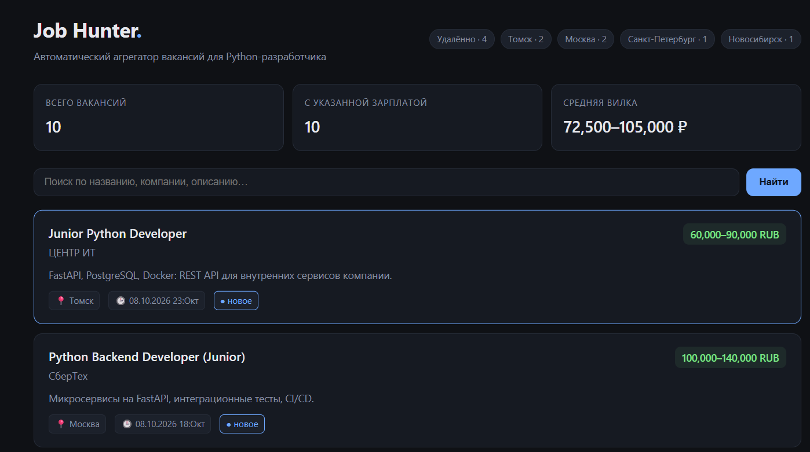

# Job Hunter

[](https://www.python.org/)
[](https://www.djangoproject.com/)
[](https://github.com/Sh0utz0011/job-hunter/actions/workflows/ci.yml)
[](LICENSE)

Автоматический агрегатор вакансий для Python-разработчика. Парсит hh.ru API по настраиваемым запросам, хранит вакансии в PostgreSQL, показывает дашборд со статистикой и поиском. В разработке: периодический автопарсинг через Celery и уведомления в Telegram через Flask-микросервис.

## Зачем нужен проект

Ручной поиск работы отнимает часы: открыть hh.ru, отфильтровать по стеку, отсеять нерелевантное, проверить, не видел ли вакансию раньше. Job Hunter автоматизирует этот цикл и заодно демонстрирует backend-навыки: Django, pytest, httpx, Docker, CI/CD.

Второй проект в портфолио. Первый — REST API на FastAPI с интеграцией локальной LLM (Ollama, Qwen 2.5), 53 теста, Docker Compose и GitHub Actions, разработан в ходе стажировки в ООО «ЦЕНТР ИТ».

## Возможности

- Парсинг вакансий hh.ru API по настраиваемым поисковым запросам
- Дашборд: статистика по зарплатным вилкам, топ городов, поиск по названию, компании и описанию
- Django Admin для управления поисковыми запросами и вакансиями
- TDD: тесты клиента, моделей и view с httpx.MockTransport, без реальных сетевых запросов
- Graceful degradation: при недоступности API (403 WAF) проект работает на демо-источнике данных
- Два режима запуска: локально на SQLite и в Docker Compose на PostgreSQL 16
- CI: прогон тестов на каждый push через GitHub Actions

## Стек технологий

| Слой | Технологии |
|---|---|
| Backend | Python 3.12+, Django 6.1 |
| HTTP-клиент | httpx (MockTransport в тестах) |
| База данных | SQLite (локально и в CI), PostgreSQL 16 (Docker Compose) |
| Тестирование | pytest, django.test.TestCase |
| Инфраструктура | Docker, Docker Compose, GitHub Actions |

## Скриншот



## Быстрый старт (локально, SQLite)

Требования: Python 3.12+, git.

```bash
git clone https://github.com/Sh0utz0011/job-hunter.git
cd job-hunter

python -m venv .venv
source .venv/bin/activate        # Linux/macOS
# .venv\Scripts\activate         # Windows PowerShell

pip install -r requirements.txt
python manage.py migrate
python manage.py createsuperuser

python manage.py seed_demo       # демо-данные
python manage.py runserver
```

Дашборд: http://127.0.0.1:8000/
Админка: http://127.0.0.1:8000/admin/

Загрузка реальных вакансий: `python manage.py fetch_vacancies`. Обратите внимание: hh.ru периодически возвращает 403 анонимным запросам (WAF), поэтому в проект встроен демо-источник для разработки и CI.

## Запуск в Docker (PostgreSQL)

```bash
docker compose up --build -d
docker compose exec web python manage.py migrate
docker compose exec web python manage.py seed_demo
```

Дашборд: http://127.0.0.1:8000/

Остановить контейнеры: `docker compose down` (данные БД сохранятся).
Полная очистка вместе с данными: `docker compose down -v`.

## Команды управления

| Команда | Описание |
|---|---|
| `python manage.py fetch_vacancies` | Загрузить вакансии с hh.ru по активным SearchQuery |
| `python manage.py seed_demo` | Наполнить базу демо-вакансиями (идемпотентна, get_or_create) |
| `python manage.py createsuperuser` | Создать администратора |
| `python manage.py test` | Запустить тесты |

## Архитектура проекта

```
job-hunter/
├── .github/workflows/ci.yml      # GitHub Actions: тесты на каждый push
├── config/                       # настройки Django, читает окружение с фолбэком
├── vacancies/
│   ├── models.py                 # SearchQuery, Vacancy
│   ├── services/hh_client.py     # HTTP-клиент hh.ru, изолирован от view
│   ├── management/commands/      # fetch_vacancies, seed_demo
│   ├── views.py                  # VacancyListView: статистика, поиск
│   ├── admin.py
│   ├── tests.py                  # pytest + TestCase + MockTransport
│   └── templates/vacancies/      # дашборд, vanilla CSS
├── Dockerfile
├── docker-compose.yml            # web + PostgreSQL 16, healthcheck и depends_on
├── manage.py
├── requirements.txt
└── README.md
```

### Принятые решения

1. HTTP-клиент изолирован в services/. View и команды не знают о деталях HTTP, клиент подменяется моками в тестах и может быть заменён без переписывания остального кода.
2. Настройки БД читаются из переменных окружения с фолбэком на SQLite (12-factor). Один и тот же код работает локально, в Docker Compose и в CI без правок.
3. Идемпотентные management-команды на get_or_create: повторный запуск не создаёт дубликатов, команды безопасны для расписания и CI.
4. В docker-compose у PostgreSQL настроен healthcheck, а web зависит от него через condition: service_healthy. Приложение не стартует раньше, чем база реально готова принимать соединения.
5. Graceful degradation: при 403 от hh.ru клиент возвращает пустой список вместо исключения, проект остаётся работоспособным на демо-данных.

## Roadmap

Готово:
- [x] MVP: Django + hh.ru клиент + дашборд + тесты
- [x] Docker Compose + PostgreSQL 16
- [x] GitHub Actions CI: прогон тестов на каждый push

В разработке:
- [ ] Celery + Redis: периодический автопарсинг по расписанию
- [ ] Flask-микросервис уведомлений в Telegram

Запланировано:
- [ ] Фильтры по стеку технологий (FastAPI, Django, парсинг)
- [ ] Сортировка по зарплате и дате публикации
- [ ] Пагинация с кнопками
- [ ] Экспорт вакансий в CSV
- [ ] Метки «прочитано», «откликнулся»

## Как тестируется проект

```bash
python manage.py test
```

- Модели: валидация полей, уникальность external_id, формат вывода зарплаты
- HTTP-клиент: парсинг ответа hh.ru, очистка HTML в сниппетах, обработка ошибок
- View: рендеринг списка, поиск через параметр q, пустое состояние
- Команды: идемпотентное создание записей

Все HTTP-тесты используют httpx.MockTransport: ни один тест не делает реальных сетевых запросов, прогон занимает доли секунды и стабилен в CI.

## Вклад

Pull requests и issues приветствуются. Для крупных изменений сначала откройте issue, чтобы обсудить подход.

## Лицензия

MIT. См. файл LICENSE.

## Автор

Олег Власов, Python Backend Developer (Junior)
- Email: oleg.vlaso@bk.ru
- Telegram: @sh0utz
- GitHub: Sh0utz0011
- Томск, готов к удалённой работе